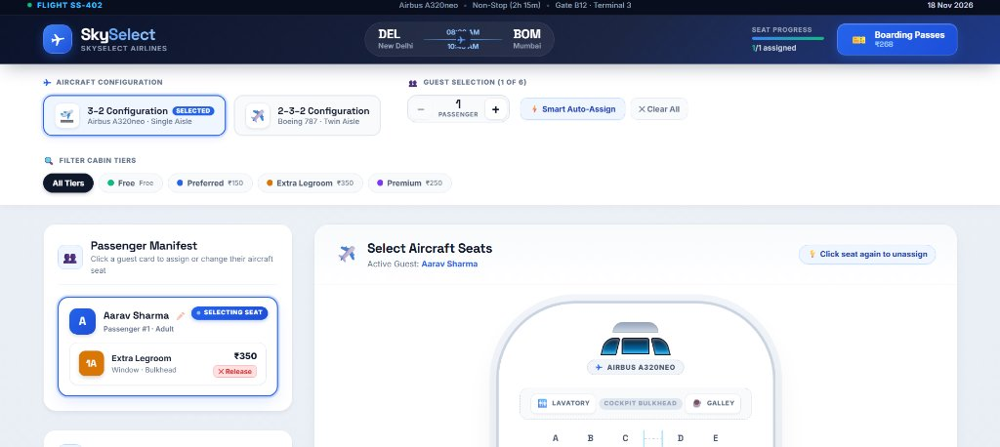
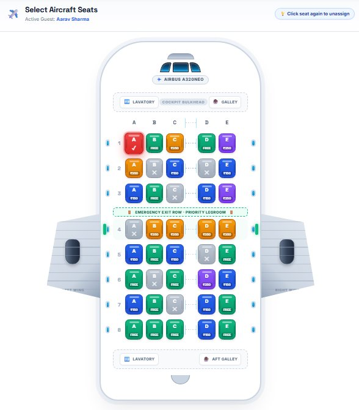
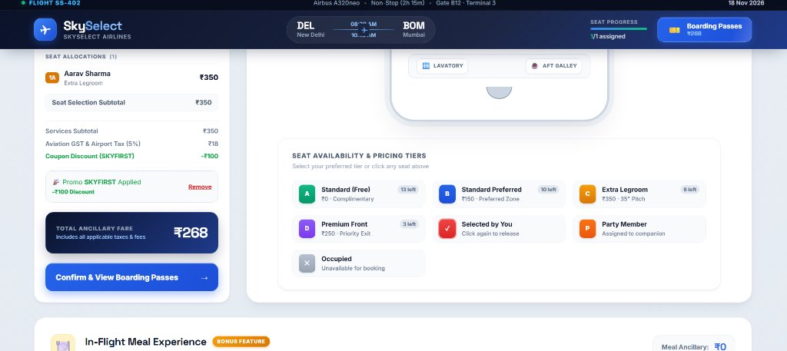
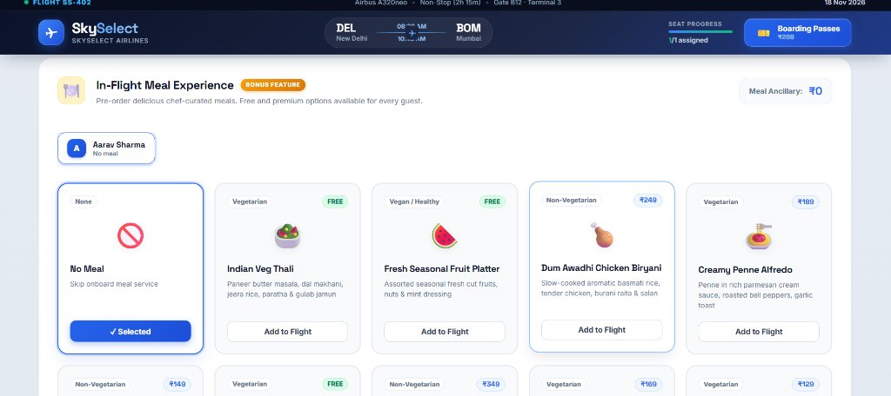
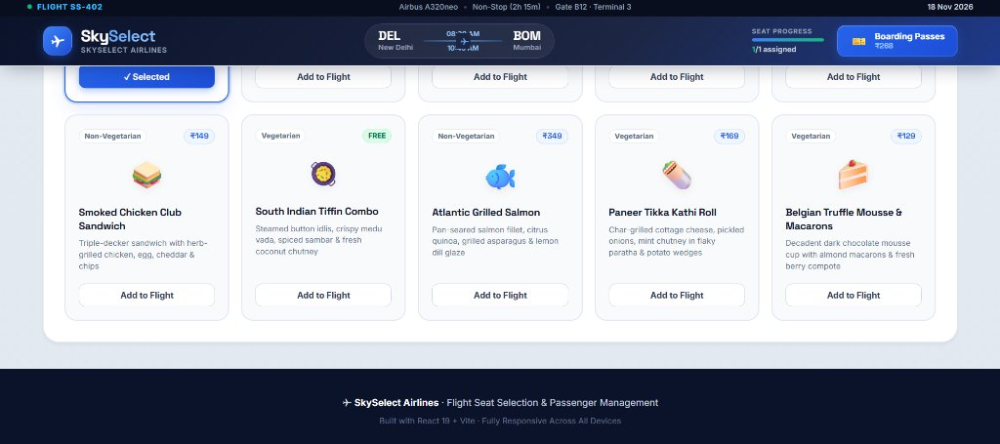
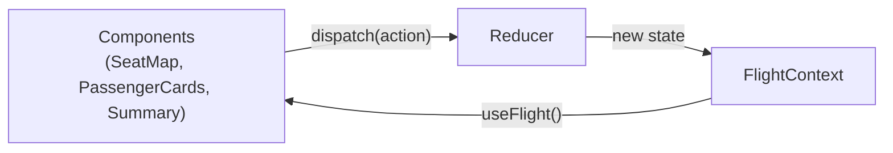
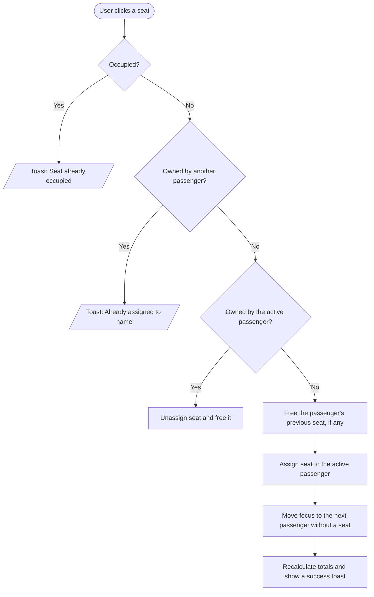

<div align="center">

# ✈️ SkySelect

### Flight Seat Selection & Passenger Management

Choose a passenger, pick a seat, and watch the total update instantly.

[](https://flightseat-selection-bay.vercel.app/)
[](https://github.com/guptaarpita/flight-seat-selection)


<br/>



</div>

---

## 📑 Table of Contents

- [Overview](#-overview)
- [Features](#-features)
- [Screenshots](#-screenshots)
- [Requirements Checklist](#-requirements-checklist)
- [State Management](#-state-management)
- [Seat Assignment Logic](#-seat-assignment-logic)
- [Pricing](#-pricing)
- [Seat Categories](#-seat-categories)
- [Meal Selection (Bonus)](#-meal-selection-bonus)
- [Tech Stack](#-tech-stack)
- [Project Structure](#-project-structure)
- [Running Locally](#-running-locally)
- [Deployment](#-deployment)

---

## 🌟 Overview

SkySelect is a front-end only flight seat selection interface for a **Delhi (DEL) → Mumbai (BOM)** flight. Users choose the number of passengers, view the aircraft cabin, assign one seat to each passenger and see a live breakdown of all charges. All data is mock data and no backend is used.

---

## ✨ Features

| | Feature | Details |
|---|---|---|
| 👥 | **Multi-passenger** | 1 to 6 passengers, switch between guests at any time, assignments are retained |
| 🛩️ | **Two aircraft layouts** | **3–2** (Airbus A320neo) and **2–3–2** (Boeing 787 Dreamliner) with a one-click toggle |
| 💺 | **Clear seat states** | Available, free, occupied, selected by you and taken by another passenger |
| 💰 | **Dynamic pricing** | Free, preferred, premium and extra-legroom seats, with a live total |
| 🍽️ | **Meal selection** | One meal per passenger, free and paid options, included in the total |
| 🔔 | **Instant feedback** | Toast messages for invalid actions such as clicking an occupied seat |
| 📱 | **Responsive** | Works from 320px phones to large desktops, with a mobile bottom action bar |
| ♿ | **Accessible** | Keyboard navigation with `Tab`, `Space` and `Enter` |
| 🎫 | **Extra** | Boarding pass modal with route, gate and barcode |

---

## 🖼️ Screenshots

### Dashboard: route, layout toggle, passenger manifest


### Seat map (3–2, Airbus A320neo)
<div align="center">

</div>

### Booking summary, pricing tiers and promo code


### In-flight meal selection (bonus)



---

## ✅ Requirements Checklist

| Area | Weight | How SkySelect meets it |
| :--- | :---: | :--- |
| **UI/UX and visual implementation** | 20% | Fuselage-style cabin, colour-coded seat tiers, hover tooltips, animations and toast notifications |
| **Seat layout and configuration** | 20% | Both layouts supported, with true aisle spacing, row numbers, seat labels and exit rows |
| **Passenger and seat assignment** | 20% | `useReducer` store, one seat per passenger, collision prevention, change or remove a seat, state kept when switching |
| **Pricing and totals** | 15% | Per-seat price, per-passenger breakdown, meal charges, GST, promo codes and an instant total |
| **Code quality and architecture** | 15% | Context plus a custom `useFlight` hook, reusable components, CSS Modules |
| **Responsiveness and edge cases** | 10% | Fluid layout, scrollable cabin on small screens, safe handling of passenger count reductions |
| **Bonus: meal selection** | Bonus | 10 meal options, free and paid, per passenger |

---

## 🧠 State Management

The app uses **React Context + `useReducer`** with a single source of truth. This keeps updates predictable without adding a library like Redux.



```ts
interface FlightState {
  layout: AircraftLayout;                  // "3-2" or "2-3-2"
  passengerCount: number;                  // 1 to 6
  passengers: Passenger[];                 // [{ id, name, seatId, mealId }]
  activePassengerId: string;               // guest currently choosing a seat
  seatAssignments: Record<string, string>; // { [seatId]: passengerId }
  categoryFilter: string;                  // active highlight filter
  couponCode: string;                      // applied promo code
  discountAmount: number;                  // discount in ₹
}
```

**Why two lookups?** Each passenger stores their own `seatId`, and `seatAssignments` maps each seat back to a passenger. This makes conflict checks constant time, `O(1)`, because there is no need to loop through the passenger list.

---

## 🪑 Seat Assignment Logic



**Rules enforced**

- Each passenger can hold **only one seat**.
- A seat can **never be shared** between passengers.
- Clicking your own seat again **removes** it.
- Switching passengers **keeps** all earlier assignments, since state is tied to passenger IDs.
- Reducing the passenger count **releases** the seats of removed passengers.
- Changing layout from 3–2 to 2–3–2 **clears** assignments, because seat coordinates differ.

---

## 💰 Pricing

| Charge | Rule |
| :--- | :--- |
| Seat price | Set by the seat category (see below) |
| Meal price | Free or paid, depending on the selected meal |
| GST | 5% applied to the subtotal |
| Promo codes | `FLYHIGH` and `SKYFIRST` |
| **Total** | Seat charges + meal charges + GST − discount, updated on every change |

---

## 🎨 Seat Categories

| Category | Price | Pitch | Colour |
| :--- | :---: | :---: | :--- |
| 🟢 Standard (free) | ₹0 | 30" | Emerald `#10B981` |
| 🔵 Preferred | ₹150 | 31" | Blue `#2563EB` |
| 🟣 Premium front | ₹250 | 33" | Violet `#7C3AED` |
| 🟡 Extra legroom | ₹350 | 35" | Amber `#D97706` |
| ⚫ Occupied | N/A | N/A | Grey `#94A3B8` |
| 🔴 Selected by you | N/A | N/A | Red `#DC2626` |
| 🟠 Other passenger | N/A | N/A | Orange `#EA580C` |

---

## 🍽️ Meal Selection (Bonus)

Each passenger can choose **one** meal.

| Meal | Type | Price |
| :--- | :--- | :---: |
| No meal | Opt-out | ₹0 |
| Indian Veg Thali | Veg | ₹0 |
| Fresh Seasonal Fruit Platter | Vegan | ₹0 |
| South Indian Tiffin Combo | Veg | ₹0 |
| Smoked Chicken Club Sandwich | Non-veg | ₹149 |
| Paneer Tikka Kathi Roll | Veg | ₹169 |
| Creamy Penne Alfredo | Veg | ₹189 |
| Dum Awadhi Chicken Biryani | Non-veg | ₹249 |
| Belgian Truffle Mousse & Macarons | Dessert | ₹129 |
| Atlantic Grilled Salmon | Non-veg | ₹349 |

---

## 🛠️ Tech Stack

| Layer | Choice |
| :--- | :--- |
| Framework | React 19 (functional components and custom hooks) |
| Build tool | Vite 8 |
| State | Context API + `useReducer` |
| Styling | CSS Modules with CSS variables |
| Fonts | Space Grotesk and Inter |
| Icons | Unicode glyphs, no icon library |

---

## 🗂️ Project Structure

```
flight-seat-selection/
├── docs/
│   └── screenshots/        # images used in this README
├── public/
├── src/
│   ├── components/         # SeatMap, Seat, PassengerCard, Summary, MealSelection, Toast, Header, Controls, BoardingPassModal
│   ├── context/            # FlightContext.jsx (state + reducer)
│   ├── data/               # mock seats, meals, layouts
│   ├── App.jsx
│   └── main.jsx
├── index.html
├── package.json
└── README.md
```

---

## 🚀 Running Locally

```bash
git clone https://github.com/guptaarpita/flight-seat-selection.git
cd flight-seat-selection
npm install
npm run dev
```

Open **http://localhost:5173/**

| Command | Purpose |
| :--- | :--- |
| `npm run dev` | Start the development server |
| `npm run build` | Create a production build in `dist/` |
| `npm run preview` | Preview the production build |

---

## 🚢 Deployment

**Live site:** https://flightseat-selection-bay.vercel.app/

**Vercel**
1. Push the repository to GitHub.
2. Import it at [vercel.com](https://vercel.com) using **Add New Project**.
3. Vercel detects Vite automatically (output directory `dist`).
4. Click **Deploy**.

**GitHub Pages**
```bash
npm run deploy
```

---

<div align="center">

Built by **Arpita Gupta** for the Frontend Developer Assessment.

</div>
